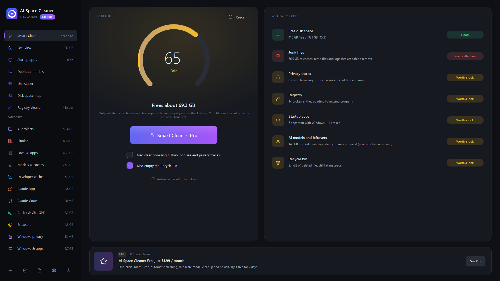
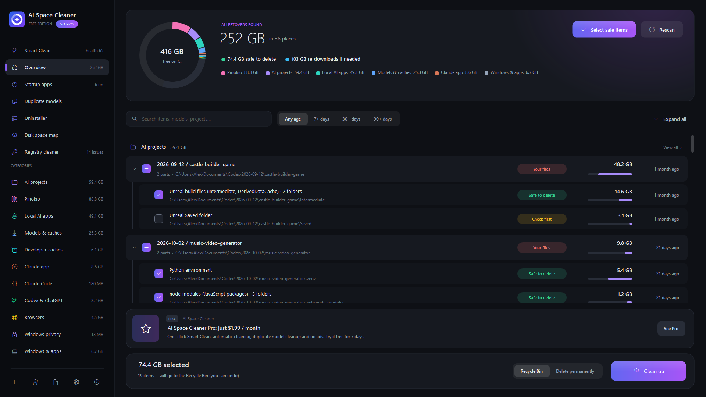
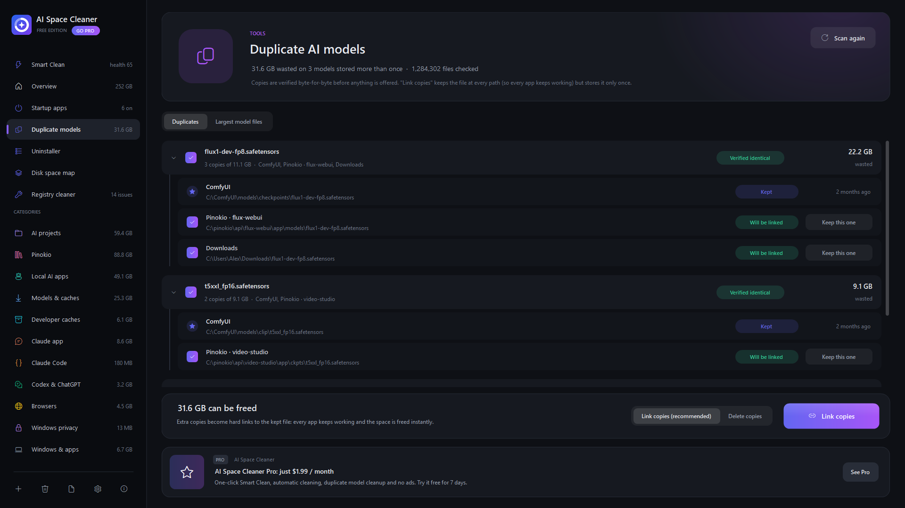
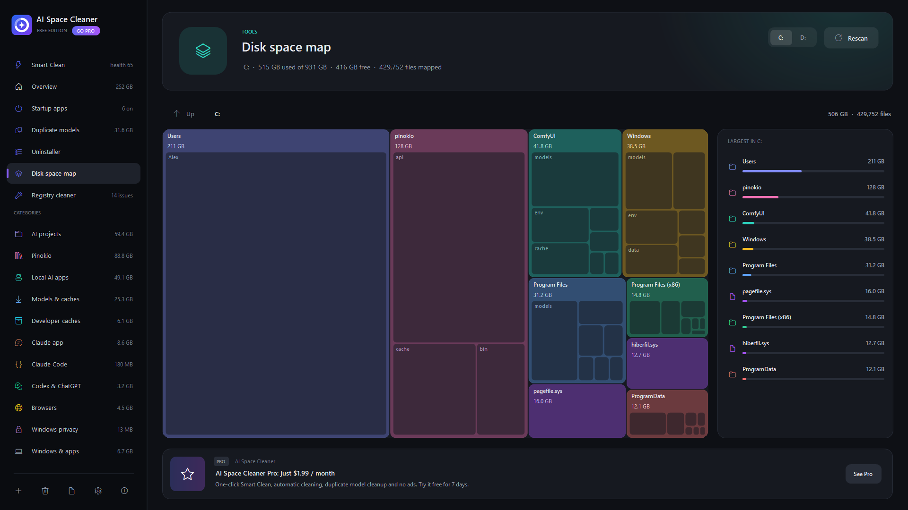
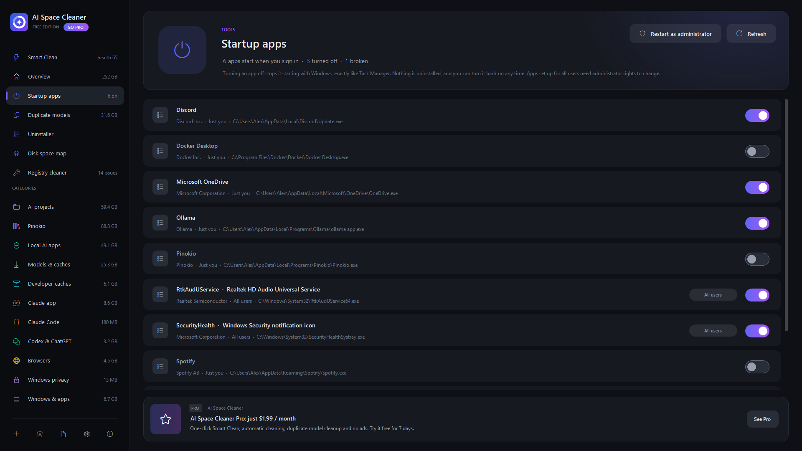
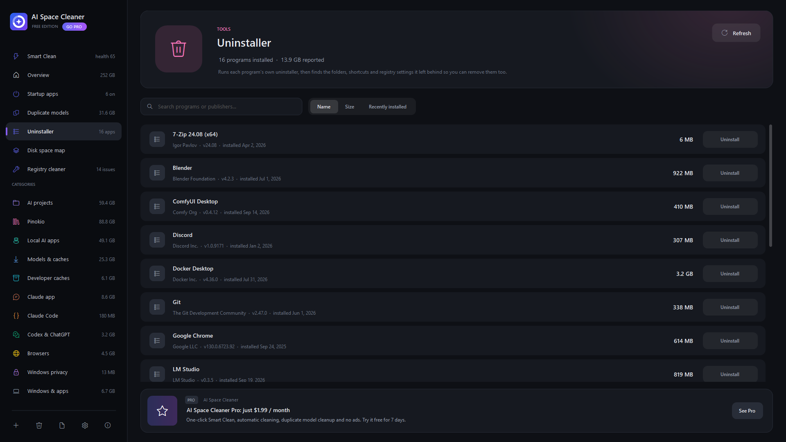
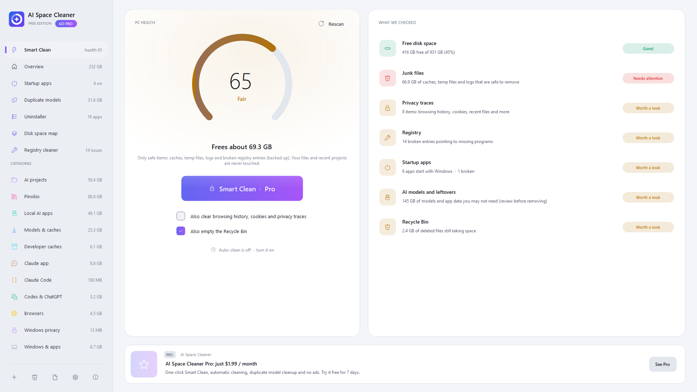

<p align="center">
  
</p>

<h1 align="center">AI Space Cleaner</h1>

<p align="center">
  <b>Free up the gigabytes your AI tools leave behind.</b><br>
  Model downloads, caches, Python environments and old projects from Claude, ChatGPT, Codex,<br>
  Pinokio, Ollama, LM Studio and ComfyUI, plus browser and Windows junk.
</p>

<p align="center">
  <a href="https://github.com/ProsperTechnology/ai-space-cleaner/releases/latest/download/AISpaceCleaner-Setup.exe"></a>
  &nbsp;
  <a href="https://prospertechnology.gumroad.com/l/aispacecleaner"></a>
</p>

<p align="center">
  
  
  
  
</p>

<p align="center">
  
</p>

## Why

AI tools are huge, and they don't clean up after themselves. A few months of trying out apps in Pinokio, models in Ollama or LM Studio, and workflows in ComfyUI can easily fill 100 GB or more with:

- the **same multi-GB model stored two or three times** by different apps
- Python virtual environments and `node_modules` from projects you've stopped using
- download caches (pip, Hugging Face, npm) that quietly keep growing
- leftovers from apps you've already uninstalled

General-purpose cleaners don't know about any of this. AI Space Cleaner does.

## Features

| | |
|---|---|
| 🧠 **AI leftovers** | Finds models, environments, caches and old projects from Claude, ChatGPT, Codex, Pinokio, Ollama, LM Studio, ComfyUI and more |
| 🧬 **Duplicate AI models** | Finds identical model files stored by different apps, verified byte-for-byte, and links them so every app keeps working while the space is freed |
| 🏷️ **Safety labels** | Every item is marked *safe to delete*, *re-downloads if needed*, *check first* or *your files*. Nothing is removed without your OK |
| 🗺️ **Disk space map** | See what's filling your drive and click any block to zoom in |
| 🌐 **Browsers & Windows junk** | Chrome, Edge, Firefox and other browser caches and history, Windows temp files, logs and the Recycle Bin |
| 🚀 **Startup apps** | Turn startup apps off the same way Task Manager does |
| 🗑️ **Uninstaller** | Runs the real uninstaller, then sweeps up the folders and settings it leaves behind |
| 🔧 **Registry cleaner** | Fixes broken entries, with an automatic backup and one-click restore |
| 🎨 **Light & dark** | Follows your Windows theme and accent color |

<table>
  <tr>
    <td></td>
    <td></td>
  </tr>
  <tr>
    <td></td>
    <td></td>
  </tr>
  <tr>
    <td></td>
    <td></td>
  </tr>
</table>

## Free vs Pro

The free edition has no time limit. Pro is for people who want it to take care of itself.

| | Free | Pro |
|---|:---:|:---:|
| Scan AI tools, browsers, developer caches and Windows junk | ✅ | ✅ |
| PC health score | ✅ | ✅ |
| Manual cleaning with safety labels | ✅ | ✅ |
| Disk space map, startup manager, uninstaller | ✅ | ✅ |
| Find duplicate AI models | ✅ | ✅ |
| **One-click Smart Clean** | | ✅ |
| **Automatic cleaning** in the background (daily or weekly) | | ✅ |
| **Link or remove duplicate models** | | ✅ |
| **Registry fixes** and uninstall leftovers cleanup | | ✅ |
| **No ads** | | ✅ |

**Pro costs $1.99 a month**, and you can cancel any time. New users can **try Pro free for 7 days** right inside the app, with no card needed.

<p align="center">
  <a href="https://prospertechnology.gumroad.com/l/aispacecleaner"></a>
</p>

## Install

1. Download **[AISpaceCleaner-Setup.exe](https://github.com/ProsperTechnology/ai-space-cleaner/releases/latest/download/AISpaceCleaner-Setup.exe)**. Older versions are on the [Releases](https://github.com/ProsperTechnology/ai-space-cleaner/releases) page.
2. Run it and click **Install**. It installs just for your Windows account, so no administrator rights are needed.
3. If Windows shows *"Windows protected your PC"*, click **More info**, then **Run anyway**.

The app tells you when a new version is available. Updates are free for everyone, and your settings and license carry over.

**Requirements:** Windows 10 or 11 (64-bit). It uses .NET Framework 4.8, which is already built into Windows.

**To uninstall:** go to Windows Settings › Apps › AI Space Cleaner › Uninstall.

## Safe by design

- Nothing is deleted without your confirmation, and items can go to the Recycle Bin.
- Windows and Program Files system folders are protected and never touched.
- Registry changes are backed up first and can be restored with one click.
- Duplicate models are only linked after a full byte-for-byte check.
- Every cleanup is written to a log you can open from the app.
- The app collects no personal data. It only connects to the internet to check for updates and to verify Pro license keys.

## Verify your download

Each release lists the SHA-256 checksum of the installer. To check yours in PowerShell:

```powershell
Get-FileHash .\AISpaceCleaner-Setup.exe -Algorithm SHA256
```

## Support

Found a bug or have an idea? [Open an issue](https://github.com/ProsperTechnology/ai-space-cleaner/issues).
Pro subscribers can manage or cancel their subscription in their [Gumroad library](https://app.gumroad.com/library).

---

<p align="center">Made by <a href="https://github.com/ProsperTechnology">Prosper Technology</a> · AI Space Cleaner is freeware with an optional Pro subscription. This repository hosts releases and documentation.</p>
